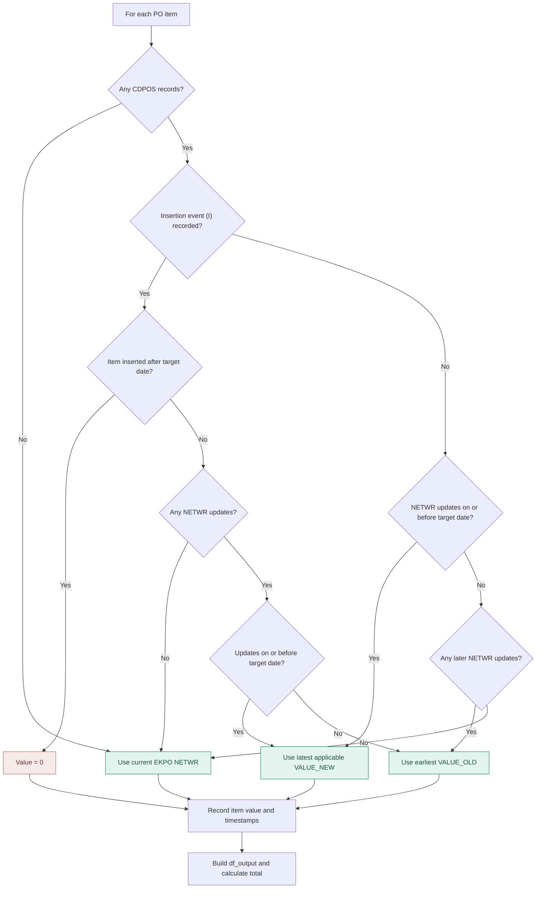

# Historical Purchase Order Value Reconstruction

## 1. Project Overview

- **Objective:** This project aims to reconstruct the historical net value of purchase orders using data extracted from SAP databases.

- **Approach:** The program examines historical change records to determine the value of individual purchase order items at a specified date.

- **Output:** The program generates an item-level report containing reconstructed values and the total net purchase order value.

## 2. Repository Structure

```text
AAA_SAP_Assignment/
├── files/
│   ├── EKKO_clean.csv
│   ├── EKPO_clean.csv
│   ├── CDHDR_clean.csv
│   └── CDPOS_clean.csv
├── functions.py
├── launch_demo.py
├── requirements.txt
└── README.md
```

## 3. Data Sources, Keys, and Relationships

### 3.1 Data Sources

| Dataset | Purpose | Relevant fields / join keys |
|---|---|---|
| `EKKO` | Purchase order headers | `MANDT`, `EBELN` |
| `EKPO` | Purchase order items and current values | `MANDT`, `EBELN`, `EBELP` |
| `CDHDR` | Change document headers (dates and times) | `MANDANT`, `OBJECTID`, `CHANGENR` |
| `CDPOS` | Individual change records and old/new values | `MANDANT`, `OBJECTID`, `CHANGENR`, `TABKEY` |

### 3.2 Relevant Keys

- **`MANDT` / `MANDANT`:** SAP client identifier.
- **`EBELN` / `OBJECTID`:** PO identifier in the purchasing-document change records used for this project.
- **`EBELP`:** PO item identifier.
- **`TABKEY`:** Composite key containing the client, PO, and item identifiers for EKPO records.
- **`CHANGENR`:** Change document number identifying a recorded change event within its document context.

### 3.3 Table Relationships

- **EKKO–EKPO:** EKKO stores PO headers, while EKPO contains the unique items associated with each PO. The tables are linked through `MANDT` and `EBELN`.

- **EKKO–CDHDR:** EKKO stores PO headers, while CDHDR records their historical change events, identified by change numbers (`CHANGENR`).

- **CDHDR–CDPOS:** CDHDR records change events and their timestamps, while CDPOS provides the detailed field-level modifications associated with each change. These tables are linked within the same client and change-document context, including `CHANGENR`.

- **EKPO–CDPOS:** EKPO tracks individual PO items (`EBELP`), which can be matched with the corresponding records in CDPOS using the `TABKEY` column, together with the client and PO identifiers.

## 4. Reconstruction Algorithm

The solution to the problem is expressed as a Python function called `get_dated_netwr()`, which carries out all the processes required to compute a PO's total net order value at a given target date.

### 4.1 Input Parameters

The function parameters / arguments are the following:

- **`mandt`:** The client identifier inside the SAP databases.
- **`ebeln`:** The PO identifier inside the SAP databases.
- **`d_date`:** The date at which we want to recover the total net order value.
- **`report`:** Boolean argument (True / Flase) to determine whether we want the function to print a report in the console or not. When set to False, the function stays silent and does not display console messages.

These parameters can either be customized or left empty, in which case the function uses default values.

### 4.2 Data Extraction and Filtering

1. **Directories:** The main Python script sets the paths to the four CSV datasets stored in the `files` folder.
2. **Extraction:** The function uses the paths to load the datasets into Pandas DataFrames.
3. **Filtering:** Each DataFrame is filtered according to the client ID (`mandt`) and the PO ID (`ebeln`).

### 4.3 Preliminary Data Validation

1. **PO Existence:** The function verifies that the requested PO and its items exist in the datasets.
2. **Date Verification:** It verifies that the requested date occurs on or after the PO creation date.
3. **Current Values:** The current total net order value is calculated by summing the current `NETWR` values of the PO items in EKPO.

### 4.4 Change History Reconstruction

1. **Change Identification:** CDHDR provides the change identifiers (`CHANGENR`) and their timestamps.
2. **Change Details:** These records are combined with CDPOS to retrieve changes affecting PO item values (`NETWR`) and item creation events (`KEY`).
3. **Item Identification:** The last five digits of `TABKEY` are extracted to identify which PO items are affected by changes.
4. **Consistency Check:** The function checks whether all PO items referenced in the reconstructed CDPOS change records also exist in EKPO and displays a warning if discrepancies are detected.

### 4.5 Historical Value Calculation

The historical value reconstruction is performed individually for each PO item through a sequence of conditional checks. The algorithm first examines whether the item has recorded creation or modification events in CDPOS. Depending on the availability and chronology of these events relative to the target date, it determines the appropriate historical value using `VALUE_NEW`, `VALUE_OLD`, the current `NETWR` value in EKPO, or zero.



### 4.6 Output Generation

1. **Item-Level Report:** The function generates a DataFrame containing each PO item, its reconstructed historical net value, and relevant timestamps when available.
2. **Total Net Order Value:** The individual historical values are summed to calculate the PO's total net order value at the requested date.
3. **Console Output:** The function displays the current PO value, the reconstructed historical report, and the associated change records.
4. **Return Values:** The function returns a Python dictionary containing the calculated values and DataFrames, allowing them to be reused in other scripts.

| Returned Key | Description |
|---|---|
| `mandt` | SAP client identifier |
| `ebeln` | Purchase order identifier |
| `current_netwr` | Current total net order value |
| `total_netwr` | Reconstructed historical total net order value |
| `df_output` | DataFrame containing reconstructed item-level values |
| `df_record_cdpos` | DataFrame containing the relevant historical change records |

## 5. Installation and Execution

### 5.1 Installation

The project requires Python and the libraries listed in `requirements.txt`.

From the project root directory, install the required dependencies:

```bash
pip install -r requirements.txt
```

### 5.2 Running the Demo

The function `get_dated_netwr()` is defined in `functions.py` and can be executed through `launch_demo.py`.

To run the demonstration from the project root directory:

```bash
python launch_demo.py
```

By default, the function uses the predefined parameters in `functions.py`. Users can also specify their own client identifier, PO identifier, and target date when calling the function.

### 5.3 Accessing the Results

The function returns a dictionary whose elements can be accessed individually for further processing.

For example:

```python
from functions import get_dated_netwr

# Execute the function
result = get_dated_netwr()

# Retrieve the historical total net order value
total_netwr = result["total_netwr"]

# Retrieve the item-level report
df_output = result["df_output"]
```

## 6. Assumptions and Limitations

1. **Incomplete Historical Records:** The reconstruction relies on the completeness and consistency of historical change records in CDPOS. Missing modifications may affect the accuracy of the calculated values.

2. **Missing Insertion Events:** When no insertion event is recorded for a PO item, its historical creation date cannot always be established. The algorithm consequently assumes that the item already existed at the requested target date.

3. **Missing Deletion Events:** Usually, the SAP CDPOS table can contain instances of 'CHNGIND == D' that point to item deletions from the PO. The function does not yet address them because they did not exist in the source data. Addressing them would require setting a PO item's value to 0 if an item was deleted and not reinserted before the target date. 

4. **Use of Current EKPO Values:** When no relevant `NETWR` modifications are recorded, the function assumes that the current value stored in EKPO also represents the historical value.

5. **Date Granularity:** The function calculates historical values at the end of the requested calendar date. It does not reconstruct values at a specific hour or minute.

6. **Data Preparation:** The original SAP datasets contained structural inconsistencies, particularly involving PO item identifiers and their associated change records. Cleaned versions of the datasets were prepared to improve consistency across the four tables. These corrections should be considered when interpreting the results.

7. **Historical Item Availability:** The reconstruction iterates through PO items present in the current EKPO dataset. Items that existed historically but are absent from the current extract may therefore be excluded from the calculation.

## 7. Self-Assessment and Declaration of AI Use

### 7.1 Self-Assessment

Overall, I did not find the assignment particularly difficult once I understood the relationships between the tables. Understanding this relational logic was the hardest part. From that point, it took me approximately one hour to write the overall function architecture, followed by perhaps another hour of testing and adjustments. For similar assignments, provided the input data does not contain structural inconsistencies, I think completing the task in under four hours is feasible.

The assignment seemed closely aligned with the kinds of advanced data manipulations I implement in other projects (see [IT-generace](https://github.com/Dany-dan-san/IT-generace)). I also realized that drawing a decision tree was particularly helpful in understanding how to structure the loop and `if`/`else` statements.

Some time was lost investigating inconsistent records between EKPO and CDPOS, where PO items referenced through CDPOS's `TABKEY` did not match items in EKPO. Based on my understanding of SAP's deletion indicators, deleted PO items are ordinarily still represented in EKPO, so deletion alone did not seem to explain the discrepancies. In the original datasets, I identified 18 problematic change records involving PO items 30 and 60 that I could not reconcile reliably without cleaning the source data.

### 7.2 Declaration of AI Use

I developed the overall algorithmic approach and assembled the final function myself, with AI assistance during debugging and the implementation of selected parts of the logic.

AI was used for:

- **Debugging and implementation support:** Identifying the causes of errors (e.g., syntax or incorrect item matching), explaining selected Python operations, and suggesting ways to implement or refine conditional branches.
- **Source data corrections:** Assisting with the correction of 18 problematic records to produce cleaned data files.
- **Copy-editing and documentation:** Partially improving my original README paragraphs and helping express the algorithm as a Mermaid decision tree.
